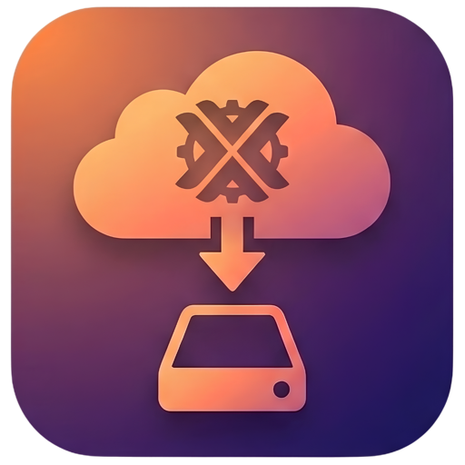
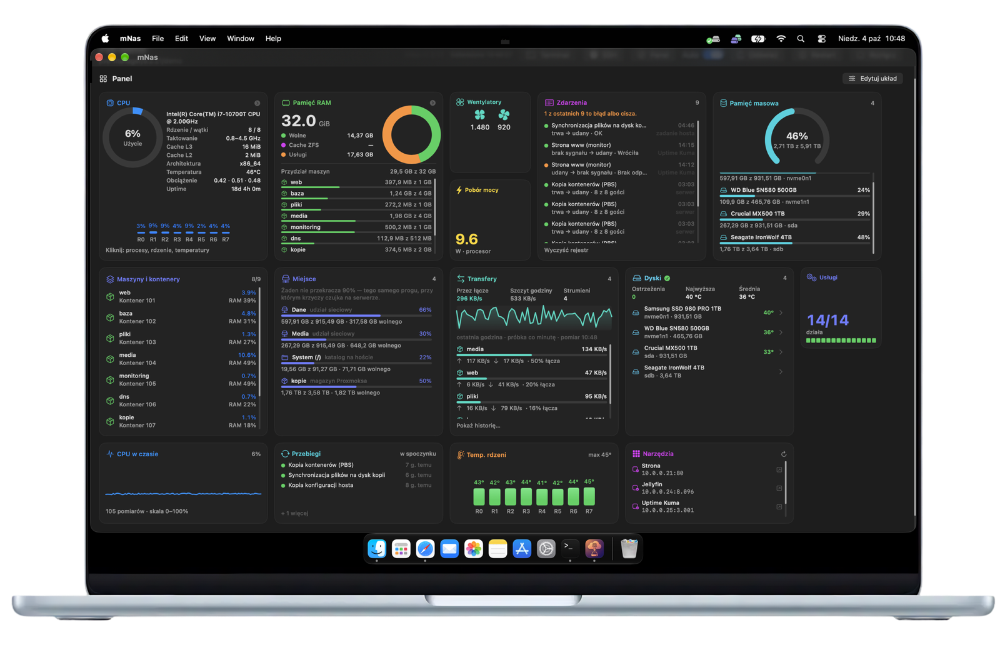
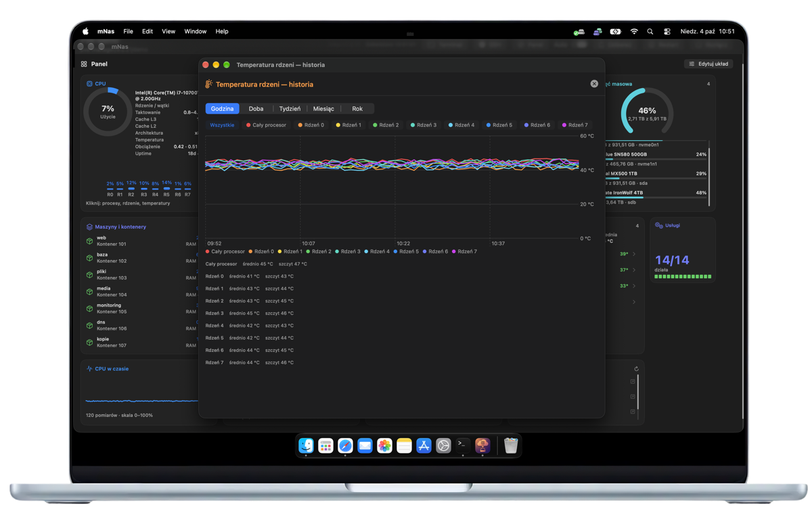
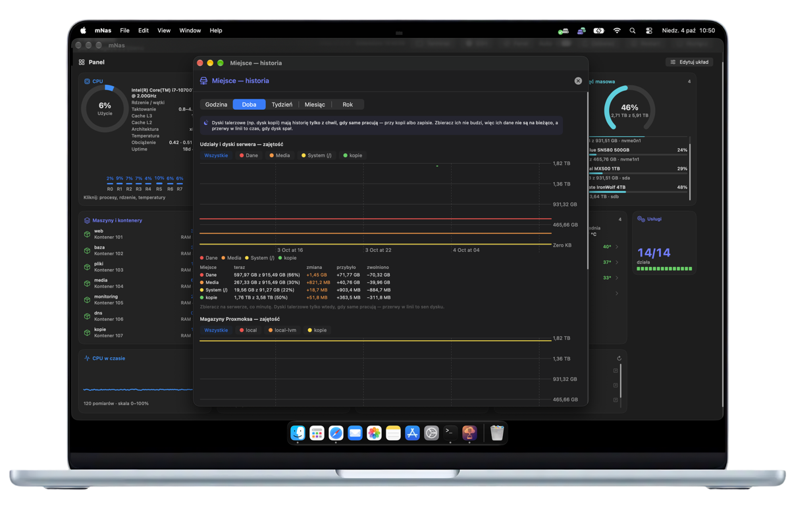
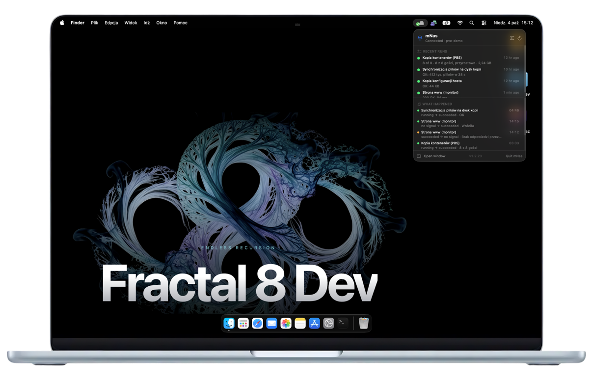
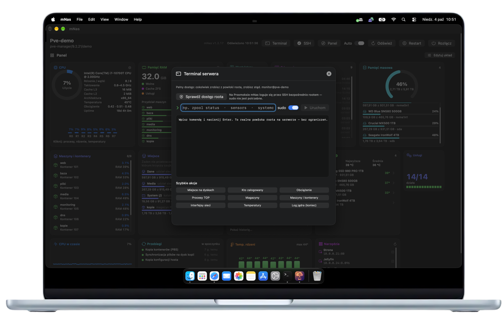

<p align="center">
  
</p>

## mNas

**Your home Proxmox server, at a glance.**
A native macOS dashboard for Proxmox VE: resources, disks, containers, backups and a
year of history on charts — in one window and in the menu bar.

[](https://developer.apple.com/xcode/)
[](https://www.apple.com/macos)
[](https://www.proxmox.com/en/products/proxmox-virtual-environment/overview)
[](LICENSE)

<a href="https://github.com/sponsors/mikagosz"></a>

Built with SwiftUI. Every tile on the dashboard opens its own window with details or
history, from the last hour to a full year. Above all, mNas is meant to *show*, not to
wear the server down: it asks about each thing only as often as that thing actually
changes, and it never wakes sleeping disks.

> Interface language: Polish and English, switchable in Settings.

<p align="center">
  
</p>

---

## Features

### Dashboard

- **Tiles you arrange yourself** — three sizes, drag them anywhere, hide or pin them.
  The layout survives a restart.
- **Menu bar** — the key tiles, recent runs and recent events without opening the
  window.
- **Click a tile** to open a window with its details or its history.

### History

- **From the last hour to a whole year** — CPU usage and load, package and per-core
  temperatures, CPU power draw (with a kWh estimate for the chosen range), memory with
  every container as its own layer, NVMe and SSD temperatures, disk space.
- **The same history on every Mac.** The server collects and keeps the data itself, so
  a second Mac sees the same charts straight away — including what happened before mNas
  was installed there.

<p align="center">
  
  
</p>

### Disks and backups

- **Where the space goes** — usage of every share and disk, what was added, what was
  freed and how much data went onto each disk in the chosen period.
- **Sleeping disks stay asleep** — spinning disks are read only when they are working
  anyway, during the nightly backup for example.
- **Disk health** — temperature, wear and SMART indicators for every drive, with a
  warning when a threshold is crossed.
- **Backups, live** — progress of the running backup, the result and duration of every
  previous one.

### Control

- **Containers and VMs** — usage of each one; start, stop and restart, always behind a
  confirmation.
- **Services** — status, start with the system, start and stop.
- **Server terminal** — a full shell on the server, inside the app.
- **Fans** — sensor readings and optional manual PWM control; mNas hands the fans back
  to automatic control when it quits.
- **Events and notifications** — a searchable log of what happened, and a notification
  when something stops working.
- **Transfers** — what flows through the server's link and which container pulls it.
- **Built-in guide** — how to create a token, connect and enable SSH, step by step,
  with commands to copy.

<p align="center">
  
  
</p>

---

## Connecting to your server

mNas needs one thing: an **API token**. SSH is an extra — it adds temperatures, fans,
SMART, the terminal and the history collector.

**Full access** (everything works, including start/stop, restart and SSH), in the
Proxmox console:

```bash
pveum user token add root@pam mnas --privsep 0
```

**View only** — mNas shows everything and changes nothing; start, stop and restart
report missing permissions, and there is no SSH:

```bash
pveum user add mnas@pve
pveum acl modify / --users mnas@pve --roles PVEAuditor
pveum user token add mnas@pve podglad --privsep 0
```

Then enter the server address and the token (`root@pam!mnas` or `mnas@pve!podglad`)
with its secret in mNas. The same steps, with commands to copy, are in
**Help → mNas Guide** inside the app.

### What mNas installs on the server

Nothing, unless you ask for history. Temperatures, power draw and disk writes need a
small collector, installed over SSH with one button in any history window
(**Install history collection**). It also installs the `rrdtool` package:

| What | Where |
|---|---|
| Collector script | `/usr/local/bin/mnas-historia` |
| systemd service and timer (once a minute) | `mnas-historia.service`, `mnas-historia.timer` |
| Collected history | `/var/lib/mnas-historia/` |

The script and both units ship as plain text in `MyApp/Zasoby/` — exactly the files
that land on the server, so you can read them before you press the button. To switch
the collector off:

```bash
systemctl disable --now mnas-historia.timer
```

## Privacy

mNas talks **only to your server**: the Proxmox API on port 8006 and, if you enable it,
SSH. No telemetry, no analytics, no account, no update check and no other connections.

- The API token is kept in the macOS keychain. Only if the keychain refuses the write
  does it fall back to a file readable by your account alone (`0600`).
- Proxmox uses a self-signed certificate, so mNas pins the server's key on the first
  connection and refuses to connect if it ever changes.
- The SSH key is generated by mNas for mNas (`ed25519`) and never leaves your Mac
  except as the public key you add to the server.

## Requirements

- macOS 26.6 or later
- Proxmox VE 9
- Xcode 26 or later to build

### Uninstalling

| What | Where |
|---|---|
| Settings | `~/Library/Preferences/com.mikagosz.mNasProxmox.plist` |
| SSH key (and the token, if the keychain refused it) | `~/Library/Application Support/mNas-Proxmox/` |
| Tile layout | `~/Library/Application Support/mNas Proxmox/` |
| Pinned server certificate | `~/Library/Application Support/mNas/` |
| SSH connection sockets | `~/.mnas-proxmox/` |
| API token | Keychain Access, service `com.mikagosz.mNasProxmox` |
| On the server | the collector files listed above, and the key line in `/root/.ssh/authorized_keys` |

## Building

```bash
git clone https://github.com/mikagosz/mNas-Proxmox.git
cd mNas-Proxmox
open mNas.xcodeproj
```

Then press ⌘R. A release build:

```bash
xcodebuild -project mNas.xcodeproj -scheme mNas -configuration Release \
    -destination 'generic/platform=macOS' CODE_SIGN_INJECT_BASE_ENTITLEMENTS=NO build
```

The project ships with a pinned local code-signing identity, which won't exist in your
keychain. Set **Signing & Capabilities → Signing Certificate** to *Sign to Run
Locally*, or point it at your own certificate.

> **Why a pinned certificate?** macOS ties keychain access to an app's code
> signature. With the default ad-hoc signature that
> identity changes on every rebuild, so the system treats each build as a new app and
> asks again. Signing with a stable certificate — even a self-signed one made in
> Keychain Access — fixes it.

## Tests

```bash
xcodebuild -project mNas.xcodeproj -scheme mNas -destination 'platform=macOS' test
```

The suite covers the API and `/proc` parsers, the history collector, disk warnings,
transfers, runs, events, the tile layout and both interface languages.

## Licence

The **source code** is MIT — see [LICENSE](LICENSE).

The **app icon** (`MyApp/Assets.xcassets`, `ikona-zrodlo.png` and
`docs/assets/mnas-icon.png`) is not covered by the MIT grant: it is
Copyright (c) 2026 mikagosz, all rights reserved, and it includes the Proxmox logo. If you fork this
project, replace it with your own.

mNas is an independent project and is not affiliated with or endorsed by Proxmox Server
Solutions GmbH. Proxmox® is a registered trademark of Proxmox Server Solutions GmbH.
